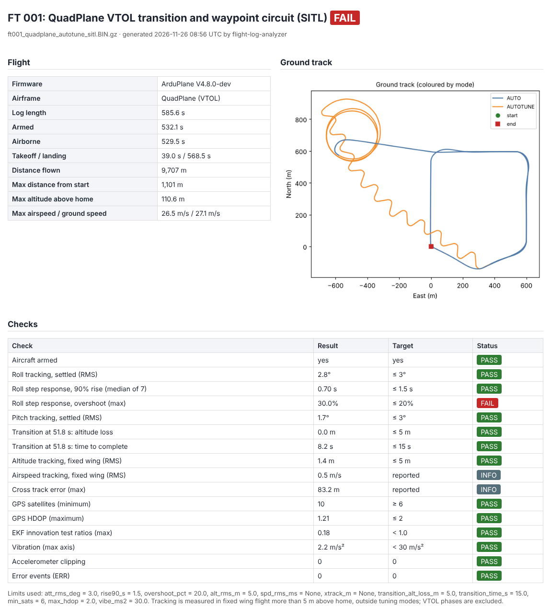
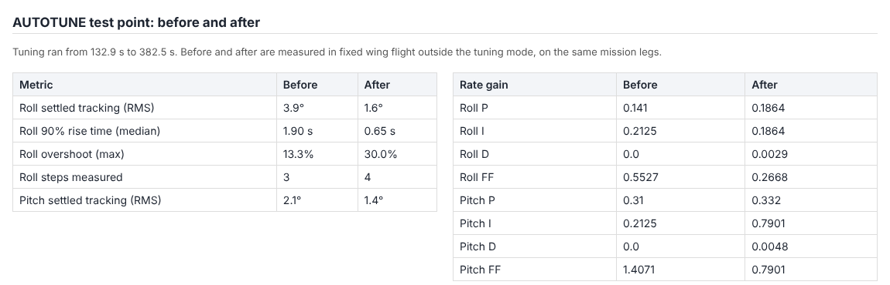
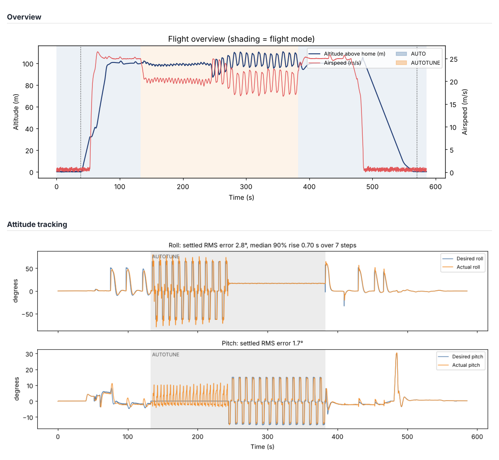

# Flight Log Analyzer

[](https://github.com/jjmmcckk/flight-log-analyzer/actions/workflows/tests.yml)

Flight test reports from ArduPilot DataFlash (.BIN) logs. One command measures attitude step
response, navigation tracking, QuadPlane transitions, before and after results for an
AUTOTUNE test point, and aircraft health, and judges them against the limits on a test card.



## Example: test card FT 001, flown in simulation

[sitl/fly_ft001.py](sitl/fly_ft001.py) flies test card FT 001 in ArduPilot's software in the
loop simulator (ArduPlane 4.8 development build, QuadPlane model), entirely in AUTO apart
from the tuning test point:

1. VTOL takeoff to 30 m, then transition to forward flight
2. Waypoint circuit at 100 m
3. Fixed wing AUTOTUNE: roll doublets until roll is finished, then pitch doublets, with
   throttle holding circuit altitude
4. The same circuit again on the tuned gains
5. VTOL approach, back transition and landing

| Result | Value |
|---|---|
| Transition | Airspeed reached in 3.2 s, complete in 8.2 s, no altitude lost (gained 9.6 m) |
| Roll 90% rise time | 1.90 s before AUTOTUNE, 0.65 s after |
| Roll settled tracking error | 3.9° RMS before, 1.6° after |
| Roll overshoot | 13.3% before, **30.0% after** |
| Health | 10 satellites, HDOP 1.21, EKF test ratios ≤ 0.18, vibration ≤ 2.2 m/s², no errors |



**Verdict: one point fails.** AUTOTUNE made the roll response about three times faster and
more than halved the tracking error, but the overshoot after tuning (30%) exceeds the card's
20% limit. The configuration ran AUTOTUNE_LEVEL 8, an aggressive setting; the next step would
be to repeat the test point at a lower level and fly the circuit again before signing off.

The full report is in [examples/ft001_report/](examples/ft001_report/) (download
`report.html` to view it), and the log is in [examples/logs/](examples/logs/).



## What it measures

| Area | Measured |
|---|---|
| Flight | Firmware, airframe (QuadPlane detected from `Q_ENABLE`), armed and airborne time, takeoff and landing, distance, max altitude and speeds, mode timeline, mission items |
| Attitude | Desired vs actual roll and pitch. For each step in demand (15° or more): time to reach 90% of the step and overshoot. Settled tracking RMS with 3 s after each step removed |
| Navigation | Altitude and airspeed tracking (TECS) and cross track error (NTUN) in fixed wing flight |
| QuadPlane transitions | Time to transition airspeed and to completion, altitude change and loss, airspeed at the end |
| AUTOTUNE | Step response before and after the tuning test point on the same legs, plus rate gains before and after |
| Health | GPS satellites and HDOP, EKF innovation test ratios, vibration and clipping, ERR events, battery |
| Ground logs | If the aircraft never armed, the pre-arm failure messages that stopped it |

Tracking is only judged in fixed wing flight more than 5 m above home and outside tuning
modes, so takeoff runs, VTOL hover and landing roll do not count against the controller.

## Test cards

Limits come from a JSON test card, so each test point is judged against its own criteria:

```json
{
  "title": "FT 001: QuadPlane VTOL transition and waypoint circuit (SITL)",
  "limits": {
    "att_rms_deg": 3.0, "rise90_s": 1.5, "overshoot_pct": 20.0, "alt_rms_m": 5.0,
    "spd_rms_ms": null, "xtrack_m": null,
    "transition_alt_loss_m": 5.0, "transition_time_s": 15.0,
    "min_sats": 6, "max_hdop": 2.0, "vibe_ms2": 30.0
  }
}
```

A limit of `null` reports the value without a pass or fail. The health defaults follow
ArduPilot guidance: vibration under 30 m/s² and EKF test ratios under 1.

## Install and use

```bash
pip install git+https://github.com/jjmmcckk/flight-log-analyzer
flightlog-report flight.BIN --limits examples/ft001_testcard.json --out report/
```

Gzipped logs (`.BIN.gz`) are read directly. The exit code is 1 if any check fails, so the
tool can gate a test sign off. Outputs: `report.html`, `summary.json`, `modes.csv`,
`events.csv` and `track.geojson`.

From Python:

```python
from flightlog import analyse, load, write_report

log = load("flight.BIN")
result = analyse(log, {"rise90_s": 1.0})
write_report(log, result, "report")
```

## Reproducing the simulated flight

Build ArduPlane for SITL from an [ArduPilot](https://github.com/ArduPilot/ardupilot) checkout
(`./waf configure --board sitl && ./waf plane`), then:

```bash
build/sitl/bin/arduplane -w --model quadplane --speedup 5 \
    --defaults Tools/autotest/default_params/quadplane.parm
python sitl/fly_ft001.py --connect tcp:127.0.0.1:5760 --autotune
```

The script uploads the mission, arms in AUTO, flies the AUTOTUNE test point with RC
overrides, and waits for the landing. The log appears in the simulator's `logs/` folder.

## How it works

- Reads the log with pymavlink's DataFlash reader into one pandas table per message type.
- Uses `STAT.isFlying` for airborne time, and QuadPlane `QTUN` messages to separate VTOL
  flight from fixed wing flight.
- Finds steps in the desired roll and pitch and measures each response against the new demand.
- Takes transition timing from the autopilot's transition messages and altitude from `POS`.

## Tests

`pytest` runs on every push: unit tests on synthetic data with known answers (a first order
lag response, arming from STAT or events, a transition with a known altitude loss, never
armed logs) and an end to end test on the committed FT 001 log.

## Credits

The example log was produced by flying [sitl/fly_ft001.py](sitl/fly_ft001.py) in ArduPilot's open source SITL simulator.
Log parsing uses [pymavlink](https://github.com/ArduPilot/pymavlink).

## Author

Jordan McKenzie, Transport Canada Advanced RPAS Pilot and Flight Reviewer, B.Sc. Computer
Science. [LinkedIn](https://www.linkedin.com/in/jordan-mckenzie-gis)

MIT License.
